<!--
  GitHub profile README for Vinh5905.
  Images in assets/generated/ are produced by `npm run build` (see docs/CUSTOMIZE.md).
  The intro paragraph below is plain text on purpose: edit it here.
-->

<picture>
  <source media="(prefers-reduced-motion: reduce) and (prefers-color-scheme: dark)" srcset="./assets/generated/hero-dark-static.svg">
  <source media="(prefers-reduced-motion: reduce)" srcset="./assets/generated/hero-light-static.svg">
  <source media="(prefers-color-scheme: dark)" srcset="./assets/generated/hero-dark.svg">
  
</picture>

データエンジニアという職種に 
強い興味があり、将来的には 
日本で働きたいと考えています。 
よろしくお願いします！😊

 

<picture>
  <source media="(prefers-reduced-motion: reduce) and (prefers-color-scheme: dark)" srcset="./assets/generated/stack-data-dark-static.svg">
  <source media="(prefers-reduced-motion: reduce)" srcset="./assets/generated/stack-data-light-static.svg">
  <source media="(prefers-color-scheme: dark)" srcset="./assets/generated/stack-data-dark.svg">
  
</picture>
<picture>
  <source media="(prefers-reduced-motion: reduce) and (prefers-color-scheme: dark)" srcset="./assets/generated/stack-devops-dark-static.svg">
  <source media="(prefers-reduced-motion: reduce)" srcset="./assets/generated/stack-devops-light-static.svg">
  <source media="(prefers-color-scheme: dark)" srcset="./assets/generated/stack-devops-dark.svg">
  
</picture>

 

<picture>
  <source media="(max-width: 600px) and (prefers-reduced-motion: reduce) and (prefers-color-scheme: dark)" srcset="./assets/generated/landscape-compact-dark-static.svg">
  <source media="(max-width: 600px) and (prefers-reduced-motion: reduce)" srcset="./assets/generated/landscape-compact-light-static.svg">
  <source media="(max-width: 600px) and (prefers-color-scheme: dark)" srcset="./assets/generated/landscape-compact-dark.svg">
  <source media="(max-width: 600px)" srcset="./assets/generated/landscape-compact-light.svg">
  <source media="(prefers-reduced-motion: reduce) and (prefers-color-scheme: dark)" srcset="./assets/generated/landscape-dark-static.svg">
  <source media="(prefers-reduced-motion: reduce)" srcset="./assets/generated/landscape-light-static.svg">
  <source media="(prefers-color-scheme: dark)" srcset="./assets/generated/landscape-dark.svg">
  
</picture>

<picture>
  <source media="(prefers-reduced-motion: reduce) and (prefers-color-scheme: dark)" srcset="./assets/generated/languages-dark-static.svg">
  <source media="(prefers-reduced-motion: reduce)" srcset="./assets/generated/languages-light-static.svg">
  <source media="(prefers-color-scheme: dark)" srcset="./assets/generated/languages-dark.svg">
  
</picture>
<picture>
  <source media="(prefers-reduced-motion: reduce) and (prefers-color-scheme: dark)" srcset="./assets/generated/activity-dark-static.svg">
  <source media="(prefers-reduced-motion: reduce)" srcset="./assets/generated/activity-light-static.svg">
  <source media="(prefers-color-scheme: dark)" srcset="./assets/generated/activity-dark.svg">
  
</picture>

アニメーションなしの画像は <a href="./docs/static.md">静止画版</a> で見られます。
