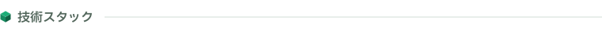

<!--
  Generated by `npm run build` from profile.config.json — edit that file, not this one.
  Images live in assets/generated/ and are refreshed daily by .github/workflows/update-profile.yml.
-->

<picture>
  <source media="(max-width: 600px) and (prefers-reduced-motion: reduce) and (prefers-color-scheme: dark)" srcset="./assets/generated/hero-compact-dark-static.svg">
  <source media="(max-width: 600px) and (prefers-reduced-motion: reduce)" srcset="./assets/generated/hero-compact-light-static.svg">
  <source media="(max-width: 600px) and (prefers-color-scheme: dark)" srcset="./assets/generated/hero-compact-dark.svg">
  <source media="(max-width: 600px)" srcset="./assets/generated/hero-compact-light.svg">
  <source media="(prefers-reduced-motion: reduce) and (prefers-color-scheme: dark)" srcset="./assets/generated/hero-dark-static.svg">
  <source media="(prefers-reduced-motion: reduce)" srcset="./assets/generated/hero-light-static.svg">
  <source media="(prefers-color-scheme: dark)" srcset="./assets/generated/hero-dark.svg">
  
</picture>

<picture>
  <source media="(max-width: 600px) and (prefers-color-scheme: dark)" srcset="./assets/generated/section-skills-compact-dark.svg">
  <source media="(max-width: 600px)" srcset="./assets/generated/section-skills-compact-light.svg">
  <source media="(prefers-color-scheme: dark)" srcset="./assets/generated/section-skills-dark.svg">
  
</picture>

<picture>
  <source media="(max-width: 600px) and (prefers-reduced-motion: reduce) and (prefers-color-scheme: dark)" srcset="./assets/generated/skills-compact-dark-static.svg">
  <source media="(max-width: 600px) and (prefers-reduced-motion: reduce)" srcset="./assets/generated/skills-compact-light-static.svg">
  <source media="(max-width: 600px) and (prefers-color-scheme: dark)" srcset="./assets/generated/skills-compact-dark.svg">
  <source media="(max-width: 600px)" srcset="./assets/generated/skills-compact-light.svg">
  <source media="(prefers-reduced-motion: reduce) and (prefers-color-scheme: dark)" srcset="./assets/generated/skills-dark-static.svg">
  <source media="(prefers-reduced-motion: reduce)" srcset="./assets/generated/skills-light-static.svg">
  <source media="(prefers-color-scheme: dark)" srcset="./assets/generated/skills-dark.svg">
  
</picture>

<picture>
  <source media="(max-width: 600px) and (prefers-color-scheme: dark)" srcset="./assets/generated/section-activity-compact-dark.svg">
  <source media="(max-width: 600px)" srcset="./assets/generated/section-activity-compact-light.svg">
  <source media="(prefers-color-scheme: dark)" srcset="./assets/generated/section-activity-dark.svg">
  
</picture>

<picture>
  <source media="(max-width: 600px) and (prefers-reduced-motion: reduce) and (prefers-color-scheme: dark)" srcset="./assets/generated/landscape-compact-dark-static.svg">
  <source media="(max-width: 600px) and (prefers-reduced-motion: reduce)" srcset="./assets/generated/landscape-compact-light-static.svg">
  <source media="(max-width: 600px) and (prefers-color-scheme: dark)" srcset="./assets/generated/landscape-compact-dark.svg">
  <source media="(max-width: 600px)" srcset="./assets/generated/landscape-compact-light.svg">
  <source media="(prefers-reduced-motion: reduce) and (prefers-color-scheme: dark)" srcset="./assets/generated/landscape-dark-static.svg">
  <source media="(prefers-reduced-motion: reduce)" srcset="./assets/generated/landscape-light-static.svg">
  <source media="(prefers-color-scheme: dark)" srcset="./assets/generated/landscape-dark.svg">
  
</picture>

今年

<picture>
  <source media="(max-width: 600px) and (prefers-reduced-motion: reduce) and (prefers-color-scheme: dark)" srcset="./assets/generated/landscape-year0-compact-dark-static.svg">
  <source media="(max-width: 600px) and (prefers-reduced-motion: reduce)" srcset="./assets/generated/landscape-year0-compact-light-static.svg">
  <source media="(max-width: 600px) and (prefers-color-scheme: dark)" srcset="./assets/generated/landscape-year0-compact-dark.svg">
  <source media="(max-width: 600px)" srcset="./assets/generated/landscape-year0-compact-light.svg">
  <source media="(prefers-reduced-motion: reduce) and (prefers-color-scheme: dark)" srcset="./assets/generated/landscape-year0-dark-static.svg">
  <source media="(prefers-reduced-motion: reduce)" srcset="./assets/generated/landscape-year0-light-static.svg">
  <source media="(prefers-color-scheme: dark)" srcset="./assets/generated/landscape-year0-dark.svg">
  
</picture>

昨年

<picture>
  <source media="(max-width: 600px) and (prefers-reduced-motion: reduce) and (prefers-color-scheme: dark)" srcset="./assets/generated/landscape-year1-compact-dark-static.svg">
  <source media="(max-width: 600px) and (prefers-reduced-motion: reduce)" srcset="./assets/generated/landscape-year1-compact-light-static.svg">
  <source media="(max-width: 600px) and (prefers-color-scheme: dark)" srcset="./assets/generated/landscape-year1-compact-dark.svg">
  <source media="(max-width: 600px)" srcset="./assets/generated/landscape-year1-compact-light.svg">
  <source media="(prefers-reduced-motion: reduce) and (prefers-color-scheme: dark)" srcset="./assets/generated/landscape-year1-dark-static.svg">
  <source media="(prefers-reduced-motion: reduce)" srcset="./assets/generated/landscape-year1-light-static.svg">
  <source media="(prefers-color-scheme: dark)" srcset="./assets/generated/landscape-year1-dark.svg">
  
</picture>

一昨年

<picture>
  <source media="(max-width: 600px) and (prefers-reduced-motion: reduce) and (prefers-color-scheme: dark)" srcset="./assets/generated/landscape-year2-compact-dark-static.svg">
  <source media="(max-width: 600px) and (prefers-reduced-motion: reduce)" srcset="./assets/generated/landscape-year2-compact-light-static.svg">
  <source media="(max-width: 600px) and (prefers-color-scheme: dark)" srcset="./assets/generated/landscape-year2-compact-dark.svg">
  <source media="(max-width: 600px)" srcset="./assets/generated/landscape-year2-compact-light.svg">
  <source media="(prefers-reduced-motion: reduce) and (prefers-color-scheme: dark)" srcset="./assets/generated/landscape-year2-dark-static.svg">
  <source media="(prefers-reduced-motion: reduce)" srcset="./assets/generated/landscape-year2-light-static.svg">
  <source media="(prefers-color-scheme: dark)" srcset="./assets/generated/landscape-year2-dark.svg">
  
</picture>

<picture>
  <source media="(max-width: 600px) and (prefers-reduced-motion: reduce) and (prefers-color-scheme: dark)" srcset="./assets/generated/charts-compact-dark-static.svg">
  <source media="(max-width: 600px) and (prefers-reduced-motion: reduce)" srcset="./assets/generated/charts-compact-light-static.svg">
  <source media="(max-width: 600px) and (prefers-color-scheme: dark)" srcset="./assets/generated/charts-compact-dark.svg">
  <source media="(max-width: 600px)" srcset="./assets/generated/charts-compact-light.svg">
  <source media="(prefers-reduced-motion: reduce) and (prefers-color-scheme: dark)" srcset="./assets/generated/charts-dark-static.svg">
  <source media="(prefers-reduced-motion: reduce)" srcset="./assets/generated/charts-light-static.svg">
  <source media="(prefers-color-scheme: dark)" srcset="./assets/generated/charts-dark.svg">
  
</picture>

アニメーションなしの画像は <a href="./docs/static.md">静止画版</a> で見られます。
