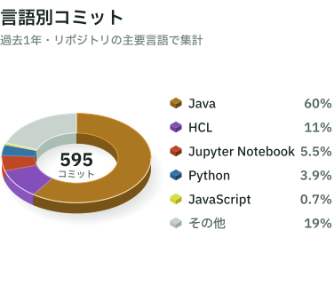

# 静止画版 / Static images

Same images as the profile, with no animation.

<picture>
  <source media="(prefers-color-scheme: dark)" srcset="../assets/generated/hero-dark-static.svg">
  
</picture>

<picture>
  <source media="(prefers-color-scheme: dark)" srcset="../assets/generated/stack-data-dark-static.svg">
  
</picture>

<picture>
  <source media="(prefers-color-scheme: dark)" srcset="../assets/generated/stack-devops-dark-static.svg">
  
</picture>

<picture>
  <source media="(prefers-color-scheme: dark)" srcset="../assets/generated/landscape-dark-static.svg">
  
</picture>

<picture>
  <source media="(prefers-color-scheme: dark)" srcset="../assets/generated/languages-dark-static.svg">
  
</picture>

<picture>
  <source media="(prefers-color-scheme: dark)" srcset="../assets/generated/activity-dark-static.svg">
  
</picture>

[← Back to the profile](../README.md)
