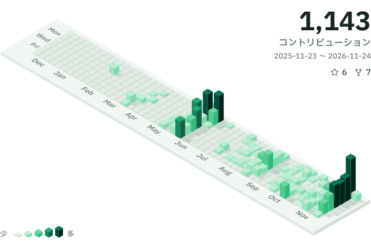
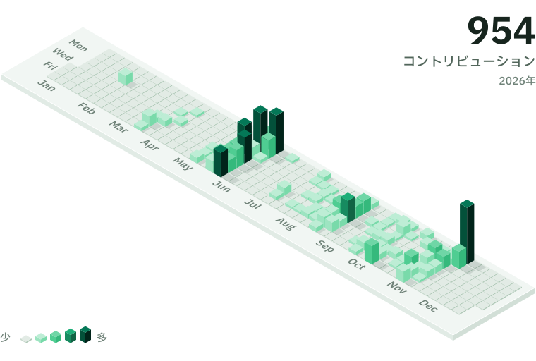
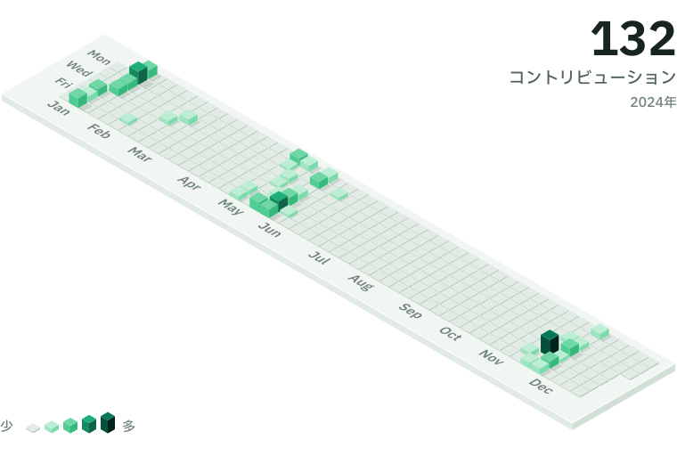
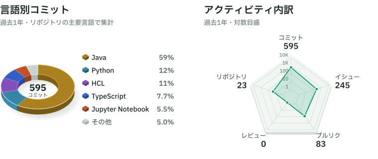

# 静止画版 / Static images

The profile images without animation (generated).

<picture>
  <source media="(prefers-color-scheme: dark)" srcset="../assets/generated/hero-dark-static.svg">
  
</picture>

<picture>
  <source media="(prefers-color-scheme: dark)" srcset="../assets/generated/skills-dark-static.svg">
  
</picture>

<picture>
  <source media="(prefers-color-scheme: dark)" srcset="../assets/generated/landscape-dark-static.svg">
  
</picture>

<picture>
  <source media="(prefers-color-scheme: dark)" srcset="../assets/generated/landscape-year0-dark-static.svg">
  
</picture>

<picture>
  <source media="(prefers-color-scheme: dark)" srcset="../assets/generated/landscape-year1-dark-static.svg">
  
</picture>

<picture>
  <source media="(prefers-color-scheme: dark)" srcset="../assets/generated/landscape-year2-dark-static.svg">
  
</picture>

<picture>
  <source media="(prefers-color-scheme: dark)" srcset="../assets/generated/charts-dark-static.svg">
  
</picture>

[← Back to the profile](../README.md)
